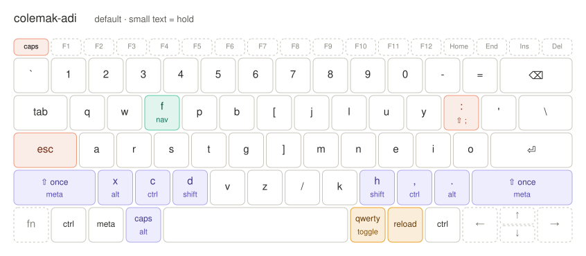
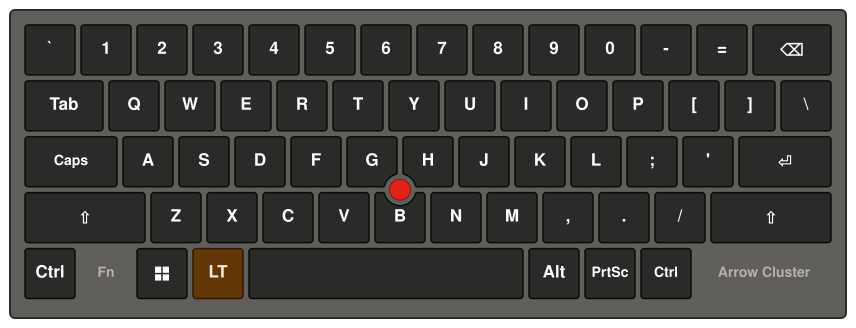

# Adi's Custom Kanata Layout

Mainly designed for my Thinkpad X13 Yoga laptop.

My custom colemak layout with "bottom-row-mods":

The default QWERTY layout:

The nav layer, so I don't have to stretch my fingers too much:

(fancy diagrams were made by my friend claude)
