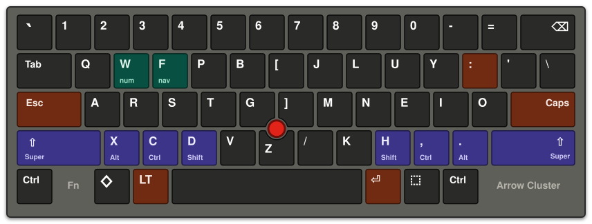
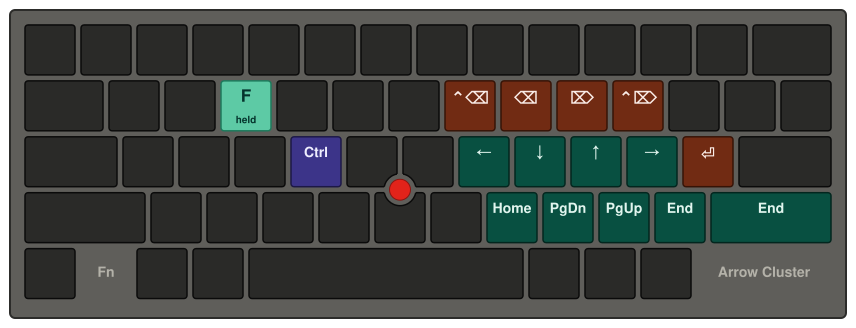
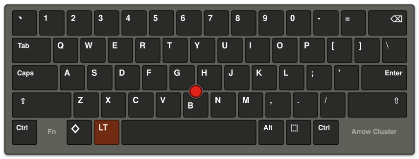

## Adi's Custom Kanata Layout

I have been using this modified colemak layout for a few years now,
finally I'm happy enough to make it open source.

I guess the most important part of this configuration is the shifted
home-row mods, or the "bottom-row mods" you see in the colemak
layout. It greatly helps reduce misfires, and I can routinely hit 100+
wpm on monkeytype with this layout.

This keyboard layout is primarily aimed at my Lenovo ThinkPad X13 Yoga
(I do not remember the model iteration, unfortunately), so it follows
the particular keyboard layout.

Also I primarily run the kanata process as root, since I use the TTY
as other users frequently. That is why I don't have any custom
commands executing from kanata. If you run kanata as another user, you
might want to do cooler things with running arbitrary commands :-)

The nav layer, so I don't have to stretch my fingers too much:

The default QWERTY layout that comes with the laptop, for reference:

(fancy SVGs were made by my friend Claude, and some of it was
hand-edited by me.)

## Testing, Compiling, Using

- `make test` runs kanata, to test. It assumes you have the relevant
  user permissions.

- `make check` runs `kanata --check`, so it just checks the
  configuration file to make sure there are no 

